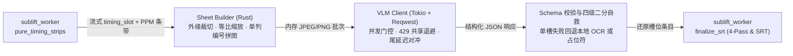

# SubLift 桌面前端与宿主架构设计与工程规范文档

本文档定义 `SubLift` 桌面前端、Tauri (Rust) 宿主与本地常驻算力进程的目标架构、模块拓扑、跨进程通信契约、多引擎协同管线及测试治理规范。本文档与 [算法核架构文档](ARCHITECTURE.md) 互为正交补充，在不侵入 `cpp/` 五层纯算法核的前提下确立桌面产品的正式目标架构。

---

## 1. 架构全景与三层拓扑（Architecture Topology）

`SubLift` 桌面端采用**纯桌面原生定位（Desktop-only）**，由前端视图层、Rust 桌面宿主与云端编排层、以及 C++20 本地常驻算力层构成严格单向解耦的三层体系：

```text
 ╔═══════════════════ 1. 前端视图层 (desktop/src - React 19 + TS) ═══════════════════╗
 ║                                                                                   ║
 ║   ui/ (组件视图：可折叠队列侧栏 · 分级混合选区画布 · 高密度虚拟列表校对器)         ║
 ║     │                                                                             ║
 ║     ▼                                                                             ║
 ║   store/ (状态编排：Zustand 统一单/多集任务队列 · 校对会话 · Provider 掩码状态)   ║
 ║     │                                                                             ║
 ║     ▼                                                                             ║
 ║   core/ (纯领域计算：时码换算 · contain 源像素 ROI 映射 · 合并/拆分/替换 · Undo)  ║
 ║                                                                                   ║
 ╚══════════════▲═════════════════════════════════════════════▲══════════════════════╝
                │ Tauri v2 Typed Commands                     │ sublift://media
                │ + Channel<TaskEvent> 流式事件               │ Range 直传 / 流式 Remux
 ╔══════════════▼═════════════════════════════════════════════▼══════════════════════╗
 ║              2. 桌面宿主与云端编排层 (desktop/src-tauri - Rust + Tokio)            ║
 ║                                                                                   ║
 ║   ┌──────────────┐  ┌──────────────────────────┐  ┌───────────────────────────┐   ║
 ║   │  commands/   │  │          vlm/            │  │          media/           │   ║
 ║   │ IPC 强类型入口│  │ 编号拼图 · 并发与限流门控 │  │ 原生 Range 零拷贝直传     │   ║
 ║   │ 原生文件对话框│  │ 尾延迟对冲 · 四级二分自救 │  │ MKV 播放态实时流式 Remux  │   ║
 ║   └──────┬───────┘  └────────────┬─────────────┘  └───────────────────────────┘   ║
 ║          │                       │                                                ║
 ║          ▼                       ▼                                                ║
 ║   ┌──────────────────────────────┴─────────────┐  ┌───────────────────────────┐   ║
 ║   │                  worker/                   │  │         storage/          │   ║
 ║   │  常驻 sublift_worker 进程守护 · 请求多路复用│  │ AppData 0600 Provider 档案│   ║
 ║   │  崩溃隔离重启 · 协作式取消路由              │  │ 指纹草稿快照 · Sheet 续传 │   ║
 ║   └──────────────────────┬─────────────────────┘  └───────────────────────────┘   ║
 ║                          │                                                        ║
 ╚══════════════════════════┼════════════════════════════════════════════════════════╝
                            │ stdio JSON-Lines 控制流 + 本地二进制/条带文件管道
                            ▼
 ╔═══════════════════ 3. 本地算力组合根与算法核 (tools/worker + cpp/) ═══════════════╗
 ║                                                                                   ║
 ║   tools/worker (sublift_worker — 唯一桌面本地组合根，零网络端口，热驻推理模型)     ║
 ║     │                                                                             ║
 ║     ├──► sublift_engine (ExtractionSession · detect_auto_region · Observer)       ║
 ║     ├──► sublift_text   (4-Pass 去重合并 · format_srt_counted 唯一权威序列化)      ║
 ║     └──► adapters       (ffmpeg · paddle [ORT] · apple_vision [macOS ObjC++])     ║
 ║                                                                                   ║
 ╚═══════════════════════════════════════════════════════════════════════════════════╝
```

### 1.1 核心设计准则与交付边界

1. **纯桌面单宿主定位（零 Web 防御税）**：剔除独立浏览器与远程服务端托管需求，前端构建产物内嵌于 Tauri 窗口，通信全量走原生 IPC 与自定义协议，**零本地 TCP 监听端口、零 Cookie/Token 会话握手、零 CORS/CSRF 校验、零工作区目录沙箱**。
2. **各司其职的跨语言分工**：
   - **C++20 / ObjC++**：专注确定性计算密集型管线（媒体探测、硬解抽帧、自动区域聚类、毫秒级变化点打轴、本地 Paddle/Vision 推理及最终 SRT 规范化输出）；
   - **Rust (Tokio)**：负责子进程看护、异步高并发多模态 HTTP 调度（限流退避、尾延迟对冲、二分降级自救）、媒体流桥接与系统私有目录安全读写，使桌面端实现**零 Python 运行时依赖**；
   - **TypeScript / React 19**：聚焦轻量级响应式交互、坐标投影与结构化字幕编辑。
3. **双轨引擎首尾同源**：无论用户选择本地 OCR（`PaddleOCR` / `Apple Vision`）还是云端/本地兼容大模型（`VLM`），前置的 `detect_auto_region` 与变化点打轴、以及后置的 `sublift_text` 4-Pass 合并与 SRT 序列化完全共用同一套 C++ 实现，杜绝双引擎时间轴与格式分叉。
4. **阶段交付边界**：当前架构阶段面向本机编译运行闭环（macOS 首发并保持跨平台可移植），暂不捆绑内嵌第三方动态库（ORT/OpenCV/FFmpeg）的独立分发 `.app` 包。

---

## 2. 目录布局与单向依赖契约

### 2.1 仓库扩展目录树

```text
SubLift/
├── cpp/
│   ├── include/sublift/{core,features,timing,text,ports,engine}/  # 既有 5 层核心不变
│   ├── src/{core,features,timing,text,engine}/
│   └── adapters/
│       ├── ffmpeg/
│       ├── paddle/
│       ├── apple_vision/                # macOS 原生 Vision OCR 适配器 (SUBLIFT_ENABLE_VISION)
│       │   ├── CMakeLists.txt
│       │   ├── include/sublift/adapters/apple_vision/
│       │   └── src/                     # ObjC++ (.mm) 私有实现
│       └── mock/
├── tools/
│   ├── cli/                             # 命令行组合根 (sublift_cli)
│   ├── worker/                          # 桌面常驻算力组合根 (sublift_worker)
│   └── vlm_ocr/                         # 离线评测与 VLM 行为对标基准工具
├── desktop/                             # 单包内聚桌面端工程 (Tauri 2 + React 19)
│   ├── package.json
│   ├── tsconfig.json
│   ├── vite.config.ts
│   ├── src/
│   │   ├── core/                        # 纯 TS 领域层：时码、ROI 坐标换算、编辑纯函数、Undo 栈
│   │   ├── store/                       # 状态编排层：Zustand 统一任务队列、校对会话、设置状态
│   │   └── ui/                          # 视图组件层：Tailwind v4 + shadcn/ui + 画布与虚拟列表
│   └── src-tauri/
│       ├── Cargo.toml
│       ├── tauri.conf.json
│       └── src/
│           ├── main.rs / lib.rs
│           ├── commands/                # Tauri #[command] 与 Channel<T> 事件出口
│           ├── worker/                  # sublift_worker 进程池、stdio 编解码与崩溃重连
│           ├── vlm/                     # Contact Sheet 拼图、并发对冲客户端、二分自救、装配器
│           ├── media/                   # sublift:// Range 直传与实时流式 Remux 管道
│           └── storage/                 # AppData 0600 凭据、文件指纹草稿与 Sheet 断点续传
└── scripts/
    └── check_dependencies.py            # 静态依赖与命名空间门禁
```

### 2.2 模块单向依赖不变式

| 层级 / 模块 | 允许依赖 | 严禁依赖或泄漏的内容 |
|---|---|---|
| `cpp/adapters/apple_vision` | `PUBLIC`: `sublift_ports`, `sublift_core`<br>`PRIVATE`: macOS `Vision` / `Foundation` / `CoreGraphics` | `engine`, `timing`, `features`, `text`；公开头文件严禁出现 Objective-C 语法或 Apple 系统框架头 |
| `tools/worker` | `sublift_engine`, `sublift_text`, `sublift_ports`, `sublift_core`, 各启用 `adapters` | 严禁被 `cpp/` 下任何库或测试反向依赖；严禁监听任何网络套接字 |
| `desktop/src/core` | 纯 TypeScript 标准库 | `react`, `react-dom`, `zustand`, `@tauri-apps/*`, DOM/BOM API, `store/`, `ui/` |
| `desktop/src/store` | `core/`, `zustand`, 注入的宿主通信抽象接口 | `react` 组件树, `ui/` 视图模块 |
| `desktop/src/ui` | `store/`, `core/`, `react`, Tailwind / `shadcn/ui`, Tauri 前端桥 | 严禁绕过 `core/` 手写重复的时码格式化、SRT 拼接或 ROI 像素取整逻辑 |
| `desktop/src-tauri/src/*` | `commands` 组合调用 `worker` / `vlm` / `media` / `storage` | `storage` 与 `media` 互不依赖；严禁在 Rust 层自行拼接最终 SRT 文本（统一交由 `worker` 的 `finalize_srt`） |

命名空间约束延续 `RULE-9`：`apple_vision` 公开头文件必须声明于 `sublift::adapters::apple_vision`，内部辅助逻辑置于 `sublift::adapters::apple_vision::detail`。

---

## 3. 本地算力组合根与 Worker IPC 协议契约

### 3.1 进程生命周期与容错语义

1. **按需拉起与热驻复用**：Rust 宿主启动后按需拉起单个常驻 `sublift_worker` 子进程；`PaddleOcrEngine` 与 `AppleVisionOcrEngine` 在首次请求时懒加载并驻留进程内存，消除自动选区与连续多集提取之间的模型冷启动开销。
2. **父子生命周期绑定**：Rust 宿主持有子进程 `stdin` 写端；宿主正常或异常退出导致 `stdin` 到达 `EOF` 时，`sublift_worker` 立即触发协作式取消（`cancel()`）并安全退出，绝不残留孤儿进程。
3. **崩溃隔离恢复**：若极端损坏媒体触发底层解码器或推理库非正常终止，Rust `worker/` 捕获子进程退出码，将当前活动任务标记为可重试错误推送给前端，自动按需重建新 Worker，**前端窗口与未导出的人工校对草稿完好保留**。

### 3.2 `stdio` JSON-Lines 协议格式

控制面采用单行紧凑 UTF-8 JSON（以 `\n` 分隔，`stdout` 严格专用于协议帧输出，诊断日志统一写 `stderr`）：

- **请求帧（Rust → C++ `stdin`）**：
  ```json
  {"id": 42, "op": "run_extraction", "params": { ... }}
  ```
- **流式事件帧（C++ `stdout` → Rust）**：
  ```json
  {"id": 42, "type": "event", "event": "progress", "data": {"current_ms": 12000, "total_ms": 60000, "fps": 118.4}}
  ```
- **终态响应帧（C++ `stdout` → Rust）**：
  ```json
  {"id": 42, "type": "result", "ok": true, "data": { ... }}
  {"id": 42, "type": "result", "ok": false, "error": {"code": "DecoderFailed", "message": "..."}}
  ```

### 3.3 核心操作原语（Operations）

| `op` 名称 | 输入关键参数 | 流式事件 / 返回契约 |
|---|---|---|
| `capabilities` | 无 | 返回编译期与运行期真实可用引擎列表（如 `["paddle", "apple_vision"]`）、`ffmpeg` 状态及支持的 `hwaccel` 模式 |
| `probe_video` | `video_path` | 调用 `FfmpegFrameSource::probe`，返回解码方向真实 `width`、`height`、`duration_ms`、`fps`、`display_transform_ok` 及 `transform_note` |
| `extract_frame` | `video_path`, `timestamp_ms`, `crop?`, `max_width?`, `out_path` | 调用 `extract_frame` 抽取指定时刻高清原片帧（原子写出图像文件并返回实际宽高），服务静帧画布与局部 VLM 取图 |
| `detect_auto_region` | `video_path`, `engine`, `script`, `bottom_ratio` | 调用 `sublift::detect_auto_region` 执行关键帧采样与双峰回扫，返回 `detected`、推荐 `SourceBox`、`confidence` 与样本文本 |
| `run_extraction` | `video_path`, `mode` (`"local_ocr"` \| `"pure_timing_strips"`), `engine?`, `region_box?`, `config`, `strips_dir?` | - `local_ocr`：流式推送 `progress` 与 `subtitle_entry`，终态返回经 4-Pass 合并的 `entries` 与 `metrics`<br>- `pure_timing_strips`：启用 `pure_timing + retain_midpoint_in_pure_timing`，边打轴边原子写出中点条带并实时推送 `timing_slot` 事件（含 `index`, `start_ms`, `end_ms`, `strip_path`） |
| `recognize_strips` | `engine` (`"paddle"` \| `"apple_vision"`), `strip_paths[]`, `script` | 对指定单槽条带执行本地 OCR 识别，供 VLM 四级二分自救后的单槽兜底使用 |
| `finalize_srt` | `entries[]`, `apply_merge` (`bool`), `min_duration_ms?`, `merge_gap_ms?` | 可选执行 `sublift::text::merge_entries`，并调用 `format_srt_counted` 返回唯一权威 UTF-8 `.srt` 文本与有效条目数 |
| `cancel_task` | `target_id` | 线程安全触发对应活动任务 `session.cancel()` / `frame_source.cancel()`，目标请求以 `Aborted` 终态快速收敛 |

---

## 4. 三引擎协同与 Rust 原生 VLM 流式管线

### 4.1 引擎矩阵与动态暴露

- **`PaddleOCR`（全平台默认本地引擎）**：基于 ONNX Runtime 与自适应检测像素预算，离线极速运行。
- **`Apple Vision`（macOS 原生本地引擎）**：仅在 macOS 且 `SUBLIFT_ENABLE_VISION=ON` 时编译注册，免外部模型文件开箱即用；非 macOS 平台通过 `capabilities` 自动隐藏，严禁做静默引擎降级。
- **`VLM`（多模态大模型引擎）**：由 Rust 宿主层驱动，支持任意兼容 OpenAI `/chat/completions` 视觉输入契约的云端或本地推理服务（如 MiniMax、NVIDIA NIM、本地 vLLM / Ollama）。

### 4.2 Rust 原生 VLM 流式管线（对标 `tools/vlm_ocr`）

桌面端在 `desktop/src-tauri/src/vlm/` 内以纯异步 Rust 原生实现完整多模态识别管线，行为严格对齐 `tools/vlm_ocr`：



1. **流式边打轴边推理**：后台任务实时消费 `run_extraction(pure_timing_strips)` 推送的条带文件，完成全宽字幕带左右各 10% 外缘裁切与等比高度归一化（读取进内存后立即删除临时 `.ppm` 条带），积满单张拼图容量或打轴流结束即刻拼装带 `[#k]` 编号标头的纵向 Contact Sheet 送入请求池。
2. **全局限流门控与尾延迟对冲**：
   - 共享 `RateLimitGate` 统一解析 HTTP `429` / `Retry-After` 并施加带随机抖动的指数退避，防止并发雪崩；
   - 根据 Provider 档案自适应注入 `thinking_mode` 参数；
   - 当任务进入收尾阶段且个别在途请求显著慢于已完成分位耗时时，在限流门允许前提下自动发起投机对冲请求（Tail Hedging），先返回合法结果者胜出并取消慢请求。
3. **四级二分降级自救与单槽兜底**：当单张 Contact Sheet 遭遇内容审核拦截（`content_filter` / `refusal`）、长度截断或 JSON Schema 校验失败时，自动按二分法递归拆分子表重试（最多四级至单槽粒度）；若单槽仍被远端拒绝，委托 `sublift_worker` 的 `recognize_strips` 执行本地 OCR 兜底（若无可用本地结果则标记占位符并阻断错误相邻合并）。
4. **Sheet 级断点续传**：每完成一张 Contact Sheet 的校验即在 `AppData` 原子更新对应视频与参数指纹下的 `.partial.json`；中途断网、取消或重启应用后再次执行时自动跳过已落盘槽位，避免重复消耗 Token。

### 4.3 校对阶段局部 VLM 重识闭环

主提取任务保持纯粹的单引擎执行语义；在提取完成进入校对态后：
- 前端自动高亮标记本地 OCR 低置信度条目（如 `confidence < threshold`）；
- 用户可手动多选任意存疑条目，或一键触发**“复核全部低置信度条目”**；
- Rust 宿主按选中条目的时间区间中点调用 `extract_frame` 截取原片字幕条带，复用同一套 `vlm/` 拼图与校验管线获取高精度文本，写回前端生成一条可一键 `Undo` 回退的修订记录。

---

## 5. 统一任务模型、分级混合预览与校对交互

### 5.1 单状态机统一任务模型

摒弃“单视频工作台”与“批量任务中心”双视图割裂设计，全应用采用**唯一任务队列状态机**（单视频即队列长度为 `1` 的特例）：

- **队列项生命周期**：`idle（待配置/已探测） → extracting（打轴/识别中） → ready（待校对） → exported（已导出）`，以及显式的 `cancelled` 与 `failed` 态。
- **剧集批处理连贯操作**：
  - 拖入单集时左侧队列栏可折叠收起，提供纯粹沉浸式单片体验；
  - 拖入整季多集视频时展开队列栏，用户在第 1 集通过自动探测或手动画布确认字幕带 `SourceBox` 与引擎配置后，可一键**“将当前选区与提取参数应用至队列其余待处理视频”**并顺序调度执行；
  - 点击队列中任意已完成剧集，右侧画布与校对列表瞬时切换至该集草稿，并支持一键**“批量导出已完成任务至原片同目录同名 `.srt`”**（提供同名覆盖确认或编号避让策略）。

### 5.2 分级混合视频预览契约

针对硬字幕提取兼顾“全编码秒开框选核对”与“动态播放听音对轴”的双重诉求，采用两级无预转码预览机制：

1. **第一级：FFmpeg 精准静帧定位画布（全格式零等待保底）**
   - 任何 `FfmpegFrameSource` 可解码容器与编码（含 MKV、10-bit HEVC/AV1、TS、非标音轨），打开视频即通过 `probe_video` + `extract_frame` 秒开展示高清静帧；
   - 时间轴滑块拖动（带请求防抖与最新代际丢弃）、`-5s / -1s / +1s / +5s` 双档步进或点击右侧任意字幕行，均精准定位至对应原片毫秒帧；
   - **选区像素严格对齐**：画布按 `probe_video` 返回的旋转后真实解码宽高计算等比 `contain` 显示矩形（黑边区域不响应新建框选，拖拽越界自动裁切至有效画面边缘），归一化坐标与源像素 `SourceBox` 之间的双向取整裁剪规则由 `desktop/src/core` 唯一定义，确保前端所见框选与 C++ 实际裁剪区域零像素偏差。
2. **第二级：`sublift://` 按需动态音视频播放**
   - WebView 原生兼容容器与音视频轨（如标准 MP4 H.264/HEVC + AAC）：通过 Tauri `sublift://media` 自定义协议直接响应 `206 Partial Content` HTTP `Range` 字节切片，零拷贝直播；
   - 容器或音轨不兼容素材（如 MKV 或 EAC3/DTS 音轨）：**严禁在导入时后台整片落盘预转码**；仅当用户显式点击播放按钮时，由 Rust `media/` 从当前播放时刻按需拉起 `ffmpeg` 实时流式重封装管道（视频流兼容时 `-c:v copy` 零重编码，仅将音轨轻量转封装为 fragmented MP4 流），暂停、拖拽跨度跳转或切换任务时立即终止旧管道进程，实现零磁盘缓存膨胀。

### 5.3 高密度虚拟列表校对器

右侧校对面板面向千条级长片字幕的高效文本审阅，不引入重型音频波形图轨道：
- **虚拟滚动与联动**：仅渲染视口可见行，保障数千条字幕编辑与滚动 60fps 流畅度；选中条目自动同步定位左侧画布时间点。
- **结构化编辑能力**：支持行内文本修改、起止毫秒时码微调（校验 `end_ms > start_ms`）、删除条目、相邻条目合并、按文本光标位置及时间比例一键拆分为两条、全片/跨队列批量查找替换（便于统一修正剧集人名译名），以及完整的内存 `Undo / Redo` 历史栈（`⌘Z` / `⇧⌘Z`）。
- **唯一权威 SRT 输出**：无论是单集“另存为”还是队列批量写盘，前端仅提交结构化 `SubtitleEntry[]` 快照，必须经由 `sublift_worker` 的 `finalize_srt` 调用 C++ `sublift::text::format_srt_counted` 生成最终字节流并由 Rust 执行临时文件原子替换写盘。

---

## 6. 私有存储与凭据安全治理

1. **零污染用户媒体目录红线**：应用运行期的任何队列状态、校对草稿、帧预览缓存或 VLM 断点文件，**严禁写入用户视频所在目录**；用户媒体目录仅在显式触发导出操作时产生目标 `.srt` 文件。
2. **系统 `AppData` 私有目录结构**：
   - `providers.json`（POSIX 权限强制设为 `0600`）：管理多套 VLM 供应商档案（预置 MiniMax、NVIDIA NIM 及自定义 OpenAI 兼容端点，包含 `base_url`、`model`、`concurrency`、`thinking_mode`）；API Key 明文仅驻留 Rust 内存与 `0600` 文件，向前端仅返回掩码摘要（如 `sk-****9f2a`），避免未公证开发包调用系统钥匙串引发的重复重编译弹窗；支持首次启动或手动一键从工作区 `.env` 导入初始化。
   - `sessions/`：按视频文件强指纹（规范化绝对路径 + 文件字节大小 + 最后修改时间戳哈希）防抖（500ms）原子保存当前队列元数据与未导出人工校对草稿，应用重启后自动无感恢复。
   - `vlm_checkpoints/`：按（视频指纹 + ROI `SourceBox` + 采样率 + 模型标识）保存 Sheet 级 `.partial.json`，任务正常收口导出后支持按配额自动清理过期缓存。

---

## 7. 分层测试治理与演进路线

### 7.1 跨栈测试门禁规范

1. **C++ 层（沿用并严守测试准入五条红线）**：
   - `cpp/adapters/apple_vision` 单测与短夹具识别测试并入既有测试分级（分别标注 `unit` 与 `adapter` 标签），严禁在 `unit` 标签下触发真实框架重负载或大媒体读写；
   - `tools/worker` 协议编解码、请求多路复用、异常输入与确定性取消测试使用管道与同步原语验证，严禁引入 `sleep_for` 竞态断言；
   - 扩展 `scripts/check_dependencies.py` 同时覆盖 `apple_vision`、`tools/worker` 与 `desktop/src/{core,store,ui}` 的单向引用检查。
2. **Rust 宿主层（`cargo test --manifest-path desktop/src-tauri/Cargo.toml`）**：
   - 覆盖 `worker/` 进程生命周期（正常问答、并发请求、取消收敛、模拟子进程崩溃自动恢复、父管道关闭回收）；
   - 覆盖 `vlm/` 裁剪缩放几何计算、编号拼图、429 限流门控退避、四级二分降级自救、尾延迟对冲及 Schema 装配器，并与 `tools/vlm_ocr` 基准测试样例做输入输出一致性校验；
   - 覆盖 `storage/` 的 `0600` 权限落盘、API Key 脱敏、草稿原子替换与损坏文件安全兜底。
3. **前端 TypeScript 层（`npm --prefix desktop test` / `Vitest`）**：
   - 100% 覆盖 `src/core/` 纯函数（毫秒时码解析格式化、`contain` 黑边裁切与 `SourceBox` 双向取整、合并/拆分/查找替换与 `Undo/Redo` 状态不变量）；
   - 覆盖 `src/store/` 统一队列状态流转、首集参数批量套用与局部 VLM 重识补丁回写。

### 7.2 模块化演进路线（工作分支规划）

所有具体实现均从 `dev` 切出独立工作分支推进，验收通过后压缩合并回 `dev`：

| 阶段 | 建议工作分支 | 交付目标 |
|---|---|---|
| **F1** | `feat/adapters-apple-vision` | 落地 macOS `cpp/adapters/apple_vision`（`SUBLIFT_ENABLE_VISION`）、命名空间门禁与 `unit`/`adapter` 测试 |
| **F2** | `feat/worker-stdio-host` | 落地 `tools/worker` 常驻 `stdio` JSON-Lines 组合根，打通探测、截帧、自动选区、双模提取、SRT 终态序列化与确定性取消 |
| **F3** | `feat/desktop-shell-and-bridge` | 初始化 `desktop/`（Tauri 2 + React 19 + Tailwind v4 + shadcn/ui），接通 Rust `worker/` 守护桥、`AppData` 存储与最小真实视频本地提取导出闭环 |
| **F4** | `feat/desktop-vlm-engine` | 在 Rust `vlm/` 落地流式编号拼图、多档案 Provider 管理、限流对冲、四级二分自救与断点续传，完成与 `tools/vlm_ocr` 行为对齐 |
| **F5** | `feat/desktop-media-and-roi` | 落地分级混合视频预览画布（FFmpeg 静帧秒开 + `sublift://` Range / 实时流式 Remux）与自动/手动字幕区域框选交互 |
| **F6** | `feat/desktop-workbench-and-queue` | 落地统一可折叠队列侧栏（批量套用与同目录导出）、高密度虚拟列表校对器（编辑/合并拆分/替换/Undo）及低置信度局部 VLM 重识闭环 |
