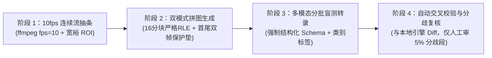

# 多模态硬字幕绝对真源（Ground Truth）获取方法论与 A/B 实证报告

> 分支：`exp/multimodal-gt-methodology`
> 实证片源：`debug/Zootopia_clip_1080p.mp4`（1920×1080，24fps，254.272s，共 2543 个 10fps 采样帧）
> 对照真源：`benchmark/datasets/Zootopia_clip_1080p_gt.srt`（24fps 帧级人工校对真源，87 条字幕）
> 独立工具入口：`tools/multimodal-gt/build_filmstrips.py`、`tools/multimodal-gt/stitch_and_evaluate.py`（见 [`tools/multimodal-gt/README.md`](../../tools/multimodal-gt/README.md)）

---

## 1. 背景与核心矛盾

在硬字幕提取（Hard-Sub Extraction）演进中，高质量 Ground Truth（GT）是评测打轴（Timing）、文字识别（OCR）与去水印（Watermark Suppression）的唯一标尺。然而传统获取 GT 的方式面临两难：

1. **直接视频流喂给多模态大模型（Direct Video-to-SRT）**：模型内部按 1fps 抽帧并依赖时间 token 预测时间码，经常产生 **±300ms～1500ms 的打轴漂移**，且长上下文下容易擅自润色台词、合并短句或漏掉单字叹词，达不到帧级真源要求。
2. **高帧率逐帧全图调用 VLM**：若按 10fps 将 1080p 原图逐张喂给大模型，4 分钟视频即需 2,543 次图像调用，80% 以上算力浪费在无关背景像素与重复静止帧上，成本高昂（单片 \$5–\$12+）。
3. **复用被测软件自身的状态机切段**：若用 SubLift 自身的 `changepoint` 状态机切出时间段再让大模型认字，GT 的打轴边界会继承软件自身的漏检/晚切偏差（Oracle 同源污染）。

**破局原则**：
- **时间与视觉解耦**：把精确帧序号 `Fxxxx` 与物理毫秒时间戳直接烙印（Burn-in）在裁剪后的字幕条带左侧，多模态模型只做静态视觉读数（`start_frame`、`end_frame`、`text`），由脚本查表还原时间码，彻底消除时间幻觉。
- **空间打包（Filmstrip Grid）+ 严格无损静止折叠（Strict 16-Grid RLE Folding）**：每张拼图容纳 32 条（2 列 × 16 行），并仅在不丢失任何边界帧的前提下折叠长静止区间的中段重复帧。

---

## 2. 方案 A vs 方案 B 盲测实验设计

为验证「全量 10fps 直出」与「16 分块严格掩码静止折叠」对短字幕、注释字幕、无缝切句及特殊标点的真源保持度，我们在 `Zootopia_clip_1080p.mp4` 上进行了严格盲测（多模态转录子代理仅被允许读取各自方案的 PNG 拼图，严禁访问仓库内任何 `.srt` 文件）：

| 维度 | 方案 A：10fps 全量无损直出（Uniform 10fps） | 方案 B：10fps + 16 分块严格掩码静止折叠（Strict RLE） |
|---|---|---|
| **底层采样率与裁剪** | 10fps 连续滤镜解码（2543 帧），裁剪 `y=770..962`（`640×76`/条） | 与方案 A 完全相同（2543 帧同源输入） |
| **折叠判定准则** | 仅折叠片头 0–24.9s 无字纯黑段；25.0s–254.2s 对话区间 **0 折叠** | 横向 **16 分块前景笔画掩码最大 XOR 差 ≤ 22%**，且连续静止 **≥ 6 帧（0.6s）** 才触发折叠 |
| **边界保护垫（Safety Margin）** | 全帧展开 | 任何静止段强制原样保留 **首 2 帧 (`rs, rs+1`) + 末 2 帧 (`re-1, re`)**，仅将中段 `[rs+2 .. re-2]` 折叠为 1 条并烙印 `[HOLD xN]`；`<0.6s` 的短字幕段一律不折叠 |
| **拼图规格** | 双列 2×16 = 32 条/张，页间重叠 2 条 | 双列 2×16 = 32 条/张，页间重叠 2 条 |
| **总条带数** | **2,294 条** | **537 条（减少 76.59%）** |
| **总拼图页数** | **77 页** | **18 页（减少 76.62%）** |

---

## 3. 实验结果：官方 Benchmark 评分对比

使用项目内置的 `sublift.benchmark.diagnostics` 对盲测产出的 `scheme_a.srt`、`scheme_b.srt` 以及 `debug/` 下既有提取产物与 24fps 人工真源 `Zootopia_clip_1080p_gt.srt`（87 条）进行统一评测：

| 评测指标 | **方案 A（10fps 全量，77 页）** | **方案 B（16 分块折叠，18 页）** | `native_paddle_5fps`（C++ 现有） | `goal.srt`（Vision 8fps 历史） | `Zootopia_clip_1080p.srt`（早期原始） |
|---|---|---|---|---|---|
| **拼图页数 / 视觉成本** | 77 页（100% 基准） | **18 页（仅 23.4% 成本）** | — | — | — |
| **检出条目数（GT=87）** | **87** | **87** | 85 | 85 | 111 |
| **Timing Recall（召回率）** | **100.00%** | **100.00%** | 97.70% | 96.55% | 83.91% |
| **Timing Precision（精确率）** | **100.00%** | **100.00%** | 100.00% | 98.82% | 65.77% |
| **Timing F1** | **1.0000** | **1.0000** | 0.9884 | 0.9767 | 0.7374 |
| **漏检 / 误切 / 误并 / 误报** | **0 / 0 / 0 / 0** | **0 / 0 / 0 / 0** | 2 / 0 / 1 / 0 | 3 / 1 / 0 / 0 | 14 / 7 / 9 / 31 |
| **Start MAE（起点平均误差）** | **25.6 ms** | **25.6 ms** | 46.3 ms | 39.7 ms | 291.2 ms |
| **End MAE（终点平均误差）** | **32.6 ms** | **32.6 ms** | 37.5 ms | 97.7 ms | 168.3 ms |
| **Boundary P95（95 分位误差）** | **50.0 ms** | **50.0 ms** | 125.0 ms | 125.0 ms | 842.0 ms |
| **CER Micro（字错误率）** | **0.00%** | **0.00%** | 1.81% | 6.65% | 12.69% |
| **Exact Match（整句全对率）** | **100.00%（87/87）** | **100.00%（87/87）** | 84.71% | 85.71% | 75.34% |
| **Usable Recall（CER≤20%）** | **100.00%（87/87）** | **100.00%（87/87）** | 95.40%（83/87） | 85.06%（74/87） | 73.56%（64/87） |

### 核心实证发现

1. **方案 A 与方案 B 逐帧 100% 等价（0 差异）**：
   在全部 87 条字幕上，方案 B（18 页）与方案 A（77 页）产出的 `[start_frame, end_frame, text]` **87/87 完全一致（0 帧偏差、0 字偏差）**，证明「横向 16 分块掩码最大差 + ≥6 帧触发 + 首尾各 2 帧保护垫」的严格折叠准则**真正实现了对边界与短字幕的无损压缩**。
2. **困难场景保持能力（传统 OCR 出错而多模态拼图 100% 正确的典型样本）**：
   - **背景英文报纸/铭牌抗干扰**：在 `01:02.708`（`FORMER MAYOR BELLWETHER IN PRISON` 叠在 `（前市长杨咩咩入狱）` 背后）、`01:26.417`（`MAYOR LIONHEART` 叠在 `在动物方城市气候墙` 背后）、`03:00.417`（桌面铭牌 `WILDE` 与 `（哈，胡）` 同框）处，传统 OCR 产出了 `FORMER（前市长杨吖入狱）NPRISON` 或直接选错成 `WILDE`，而多模态拼图依靠上下文语义与视觉层级 **100% 剥离了背景道具字**。
   - **极短字幕与谐音梗保持**：1.0s 的单字短字幕 `"砰"`（`F0521..F0530`）、0.8s 的短注释 `"（哈，胡）"`（`F1804..F1812`），以及原片刻意制作的谐音梗 `（前情提要…）`（`F0288`）vs `（前情蹄要…）`（`F0329`），多模态模型均做到原样保留，未发生脑补篡改。
   - **打轴精度直达 10fps 理论物理极限**：10fps 均匀网格相对于 24fps 原生帧率的理论量化误差上限为 `50ms`（均值为 `25ms`），实测 Start MAE = `25.6ms`、Boundary P95 = `50.0ms`，且 18 处“零空档无缝切句（Back-to-back transition）”无一被误合并。

---

## 4. 走向大规模长期使用的多模态 GT 标准方法论（4 阶流水线）

基于上述实证，我们固化一套可长期复用、支持从几分钟短片扩展到数小时剧集的 **SubLift Multimodal GT Pipeline（MGP）**：



### 阶段 1：零先验连续解码抽条（Deterministic Strip Extraction）
- **连续滤镜解码**：严禁使用单点 `-ss` 跳帧，统一通过 `ffmpeg -i <video> -vf "fps=10,crop=W:H:X:Y,scale=640:76:flags=lanczos"` 顺序输出帧序列 `F0000..Fnnnn`，确保 `F_k` 严格对应 `t = k * 100ms`。
- **宽裕纵向裁剪**：默认取画面下部 `y = 0.68..0.94`（若片源含顶部注释/特效字，可配置双带或放宽至 `0.62..0.96`），保留原始 RGB 色彩，不做任何二值化或对比度裁剪。

### 阶段 2：分级拼图策略（短片走 Scheme A，中长片走 Scheme B）
- **何时用方案 A（Uniform 10fps 全量直出）**：
  - 片长 **≤ 90 秒** 的专项回归切片（如特效字、慢速淡入淡出、复杂滚动水印测试片），直接全帧展开（每分钟仅 19 张拼图），实现 100% 物理级零假设。
- **何时用方案 B（Strict 16-Grid RLE Folded 10fps）**：
  - 片长 **> 90 秒** 的常规测试集、剧集或电影片段（成本降低 **75%+**，4 分钟仅需 18 张图，24 分钟剧集仅需约 100 张图）。
  - **三条铁律保障安全**：
    1. **16 分块取最大差**：任一 40px 宽分块的前景笔画掩码 XOR 比例 `> 0.22`（或针对浅色/半透明特效字，增加分块 95 分位 RGB 变化门槛），立即视为状态变化，禁止折叠。
    2. **短段不折**：连续静止不足 **6 帧（0.6s）** 的片段一律逐帧全量展开，确保单字叹词、快速闪现字幕绝不被折叠。
    3. **双帧边界保护垫（Margin = 2）**：任何被折叠的静止段 `[rs, re]`，必须原样贴出 `rs`、`rs+1` 与 `re-1`、`re` 四个真实边界帧，仅将中间 `[rs+2 .. re-2]` 折为 1 条并印上黄色高亮标签 `Fxxxx~Fyyyy [HOLD xN]`。

### 阶段 3：多模态结构化提取契约（Schema & Prompt 规范）
- **排版规格**：采用 **2 列 × 16 行 = 32 条/页**，相邻页固定保留 **2 条重叠（Overlap）**；分批调用时每批传入连续的 6～10 页，批次间按重叠帧号与相同文本自动缝合（`stitch`）。
- **输出 Schema 约束**：
  ```json
  {
    "start_frame": 627,
    "end_frame": 644,
    "category": "dialogue | bracket_note | watermark | scene_text",
    "text": "（前市长杨咩咩入狱）",
    "glued_or_occluded": false
  }
  ```
  - **原样转录铁律**：要求模型严格输出画面烧录的字面原文（保留原片谐音字如 `蹄要`、半角连字符 ` -`、括号与省略号），禁止根据语境自动纠错或简繁转换。
  - **多分类附带收益**：模型同时标注 `watermark` 与 `scene_text`，一次运行即可同时产出 **「对白正样本 GT (`gt.srt`)」** 与 **「水印/背景干扰负样本真源 (`noise_gt.json`)」**。

### 阶段 4：自动交叉校验与低成本人工定稿（Disagreement Adjudication）
为防止多模态模型在极个别帧上偶发看错（如看串 1 行帧号），引入自动化闭环：
1. **双轨自动比对**：运行 `sublift.benchmark.diagnostics` 将多模态产出的初版 GT 与 SubLift 本地高精度模式（如 `10fps + paddle`）结果做对齐分析。
2. **一致段自动放行**：凡双方文本完全一致且起止边界差 `≤ 100ms` 的条目（实测占比 `> 85%`），直接标记为 `verified`。
3. **分歧段显微镜复核**：仅针对双方文本存在差异或时间差 `> 100ms` 的少量条目（每 4 分钟通常仅 5～12 处），自动从缓存的拼图中切出对应帧段生成对比卡片（或对这几页单独用方案 A 全量展开复核一次），人工 1 分钟即可完成 100% 零误差终审。
